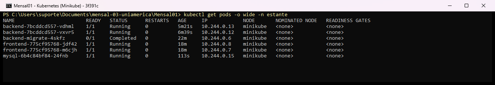
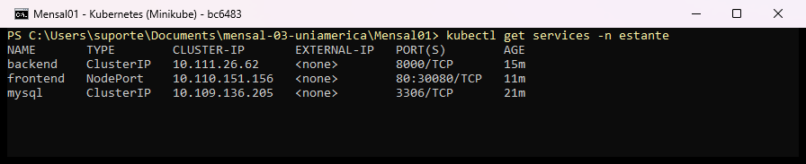
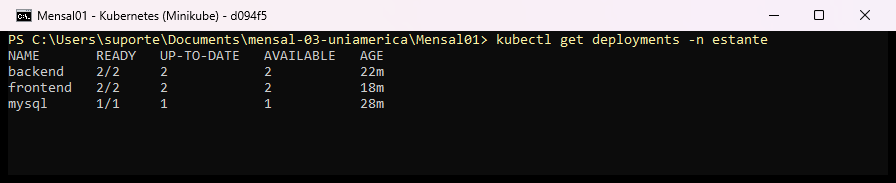
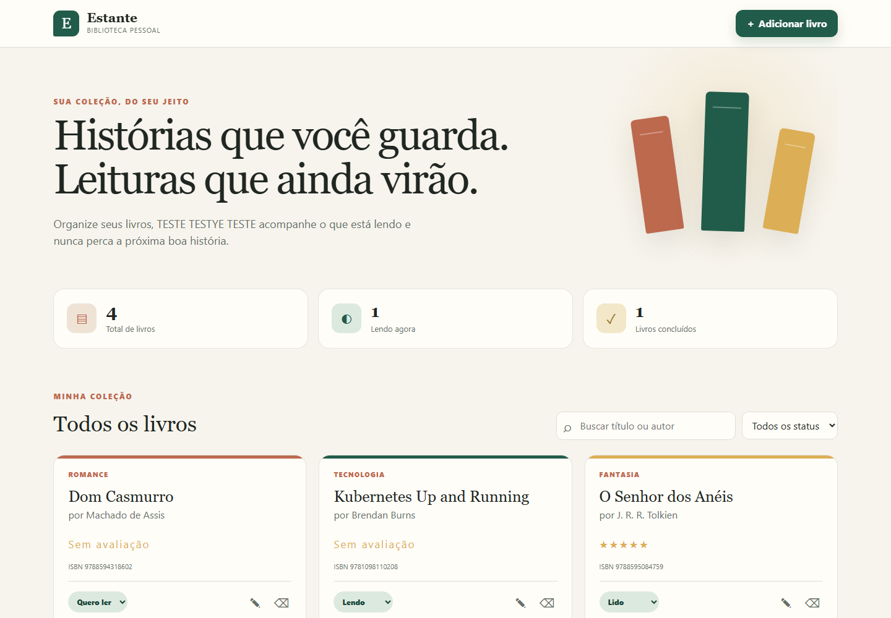
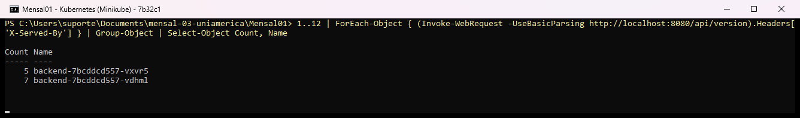
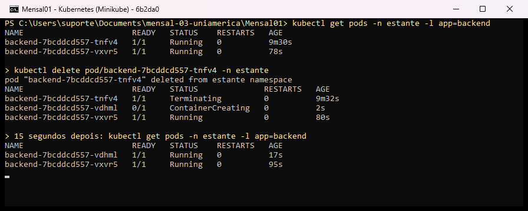
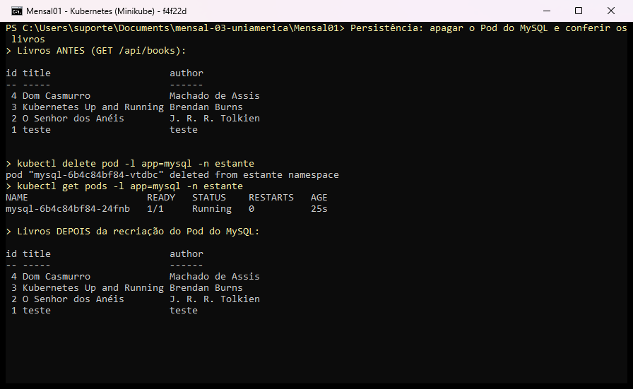

# Evidências — Execução no Kubernetes (Minikube)

Capturas feitas em 17/10/2026 com Minikube v1.39.0 e Kubernetes v1.37.0, no namespace `estante`.
As saídas em texto dos mesmos comandos estão em [`saidas-kubectl.md`](saidas-kubectl.md).

| # | Evidência | Requisito do enunciado |
|---|---|---|
| 1 | [`kubectl get pods -o wide`](01-get-pods-wide.png) | Apresentação: Pods em execução |
| 2 | [`kubectl get services`](02-get-services.png) | Apresentação: Services |
| 3 | [`kubectl get deployments`](03-get-deployments.png) | Apresentação: Deployments (backend e frontend com 2 réplicas) |
| 4 | [Aplicação no navegador](04-aplicacao-navegador.png) | Aplicação funcionando dentro do Minikube |
| 5 | [Balanceamento de carga](05-balanceamento.png) | Requisições divididas entre os 2 Pods do backend (header `X-Served-By`) |
| 6 | [Autocura](06-autocura.png) | Pod excluído e recriado automaticamente pelo Deployment |
| 7 | [Persistência do MySQL](07-persistencia-mysql.png) | (Bônus) Dados mantidos após recriar o Pod do banco (PVC) |

## 1. Pods

## 2. Services

## 3. Deployments

## 4. Aplicação no navegador
Acesso via `kubectl -n estante port-forward svc/frontend 8080:80`.

## 5. Balanceamento de carga
12 requisições a `/api/version` pelo frontend; cada resposta informa o Pod que a atendeu.

## 6. Autocura
Um Pod do backend é excluído; o ReplicaSet cria outro (`ContainerCreating`) e, segundos depois, há novamente 2 Pods `Running`.

## 7. Persistência do MySQL
O Pod do MySQL é excluído e recriado; os livros continuam no banco porque estão no PersistentVolumeClaim `mysql-data`.

